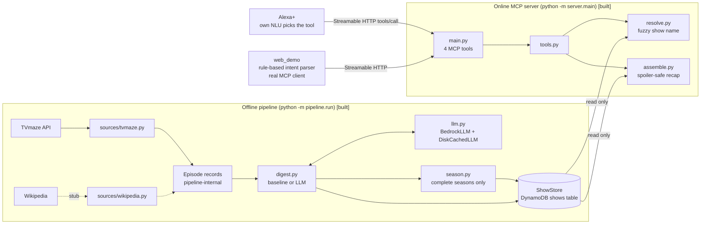
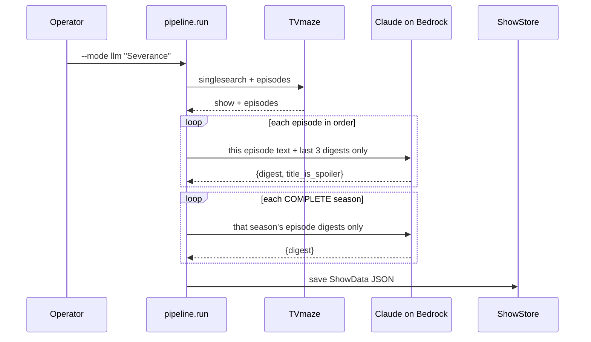
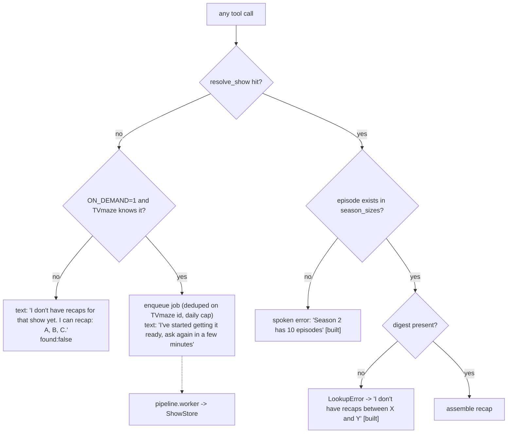

# Architecture and user flows

## 0. Simplified pipeline

1. Offline ingestion pipeline: Fetch data, ingest it & summarize it (using Bedrock)
   - Manual batch: python -m pipeline.run [--mode baseline|llm] ["Show" ...]. With no names it uses the list in pipeline/shows.yaml (Severance, The Bear etc.) [not idempotent afaik]
   - On-demand (only if ON_DEMAND=1): Fetch using TVMaze, Limit: 20 new jobs/day
   - Worker: python -m pipeline.worker polls the DynamoDB `jobs` table every 2 s under `task worker` (5 s default; `--once` drains and exits)

## 1. System overview



Boundary rule: the pipeline only **writes** `ShowStore`; the server only **reads** it. The server
never calls an LLM. The server keeps no per-user state; it only writes on-demand job records.

## 2. Data model

```
Show            id, name, aliases, season_sizes{season: n_episodes}
Episode         raw TVmaze/Wikipedia text   (pipeline-internal, never served)
EpisodeDigest   season, number, digest, title, title_is_spoiler
SeasonDigest    season, digest, episode_count   (only built when season is complete)
ShowData        show + [EpisodeDigest] + [SeasonDigest] + attribution   -> one DynamoDB item per show
Recap           show, text, starts_at, covered_through, truncated, attribution
```

## 3. Spoiler-safety rules (server/assemble.py)

1. Only episodes inside `[start, end]` are used.
2. A season digest is used only when the range covers the whole season.
3. Over the word budget (brief 90, standard 220): first sentences only, then drop the oldest.
4. `covered_through` is never later than requested; `truncated` is reported honestly.

## 4. User flows

### 4.1 Pipeline run (operator) [built]



### 4.2 "Catch me up on The Bear, I'm on season 2 episode 4" -> catch_me_up [built]

1. Alexa+ NLU picks `catch_me_up(show, season, episode)`, filling the arguments from what the
   user said. The server stores nothing about the user.
2. `resolve_show` normalizes and fuzzy-matches against stored shows (partial titles and typos).
3. Unknown show -> "I don't have that yet" (see 4.6). Beyond what is stored -> refresh (4.7).
   Episode that doesn't exist -> spoken error.
4. `assemble_recap(show, (1,1), (season, episode))` -> season digests for complete seasons,
   episode digests for the partial one, trimmed oldest-first to the word budget.
5. Returns `text`, `covered_through`, `truncated`, `attribution`.

### 4.4 "Recap X through season 1" -> get_recap [built]

Same assembly with explicit from/to. No `to_episode` means "through the end of that season".

### 4.5 "Previously on" -> get_previously_on [built]

`get_previously_on(show, season, episode, count=2)`: the `count` episodes immediately before
that episode, across season boundaries. Only episode digests, never a season digest.

### 4.6 Show or episode not in the store [built; on-demand needs ON_DEMAND=1]



### 4.7 Web demo [built]

Browser -> `POST /api/ask` -> `intent.parse` (regex) -> real MCP `tools/call` with
JSON result -> page shows tool call, result and spoken text.

## 5. Planned extensions (not built)

- **On-demand show generation**: built (`server/on_demand.py`, `common/jobs.py`,
  `pipeline/worker.py`). Still open: SQS/DynamoDB backing for the queue, upgrading a baseline
  show to LLM digests later, a per-user "notify me when ready".
- **Cumulative "story so far" digests**: one per episode, built from the previous cumulative
  digest plus the new episode. Makes `catch_me_up` a lookup of an already-smoothed summary.
- **Request-time synthesis with fallback**: optional small LLM over the selected digests, with a
  hard timeout, a cache keyed by (show, from, to, detail) and a concatenation fallback.
- **Account linking** (Cognito), DynamoDB/S3 stores, Lambda or App Runner deployment.
